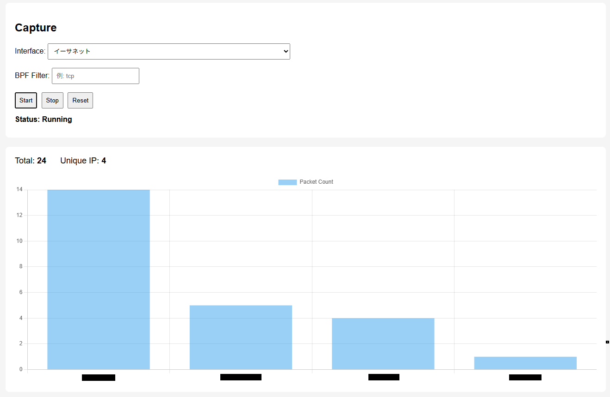

# IP Traffic Monitor Server

A lightweight web-based network traffic monitor built with Python,
Flask, and Scapy.

The application captures IPv4 packets on a selected Windows network
interface and displays packet counts grouped by source IP address in a
browser. It provides a simple interface for starting and stopping packet
capture, applying a BPF filter, viewing the most active source IP
addresses, and resetting the statistics.



## Features

-   Capture IPv4 packets from a selected network interface.
-   Display the total number of captured packets.
-   Display the number of unique source IP addresses.
-   Show the top 10 source IP addresses by packet count.
-   Start and stop packet capture from a web browser.
-   Apply a BPF capture filter, such as `tcp` or `udp`.
-   Refresh traffic statistics automatically.

## Runtime Environment

The application is intended to run locally on Windows.

  Component               Requirement
  ----------------------- ----------------------------------
  Operating system        Windows
  Python                  Python 3.13 (tested environment)
  Packet capture driver   Npcap
  Backend                 Flask
  Packet capture          Scapy
  Charting                Chart.js (loaded from CDN)
  Browser                 A modern web browser

Packet capture generally requires administrator privileges on Windows.
Npcap must be installed and configured correctly for Scapy to access
network interfaces.

## Project Structure

``` text
ip_traffic_monitor/
├── app.py
├── capture.py
├── LICENSE
└── README.md
```

-   `app.py` --- Flask application, web interface, API endpoints, and
    traffic statistics.
-   `capture.py` --- Packet capture using Scapy.
-   `LICENSE` --- GNU General Public License version 2.

## Setup

### 1. Install Python

Install Python for Windows if it is not already installed.

Python 3.13 was used in the development environment. Other Python
versions may also work, but have not necessarily been tested.

### 2. Install Npcap

Download and install Npcap:

https://npcap.com/

Use the installation options appropriate for your Windows environment.
After installation, make sure the Npcap driver is available.

### 3. Create a virtual environment (recommended)

Open PowerShell in the project directory:

``` powershell
python -m venv .venv
```

Activate it:

``` powershell
.\.venv\Scripts\Activate.ps1
```

If PowerShell blocks script execution, use an appropriate execution
policy for your environment, or run the application using the virtual
environment's Python executable directly.

### 4. Install Python dependencies

``` powershell
python -m pip install Flask scapy
```

## Running the Application

1.  Open PowerShell with administrator privileges.
2.  Change to the project directory.
3.  Activate the virtual environment, if one was created.
4.  Start the application:

``` powershell
python app.py
```

5.  Open the following address in your browser:

``` text
http://127.0.0.1:5000
```

6.  Select a network interface and optionally enter a BPF filter.
7.  Click **Start** to begin capturing packets.

Click **Stop** to request that packet capture stop. Click **Reset** to
clear the displayed packet statistics.

## BPF Filter Examples

The BPF filter field accepts filters supported by the packet capture
backend.

  Filter                Description
  --------------------- -----------------------------------------------
  `tcp`                 Capture TCP packets
  `udp`                 Capture UDP packets
  `icmp`                Capture ICMP packets
  `port 80`             Capture packets using port 80
  `host 192.168.1.10`   Capture packets to or from the specified host

An empty filter captures packets without an additional BPF restriction.

## Notes and Limitations

-   The current implementation processes IPv4 packets. IPv6 traffic is
    not included in the displayed statistics.
-   The application is designed for local use and binds to `127.0.0.1`
    by default.
-   Packet capture may fail if the application is not started with
    sufficient privileges or if Npcap is unavailable.
-   The **Stop** operation requests termination of packet capture.
    Depending on packet activity and the capture backend, shutdown may
    not be immediate.
-   Chart.js is loaded from a public CDN, so an internet connection may
    be required for the chart to render.
-   This project is intended for learning, development, and network
    troubleshooting. Only capture traffic on networks and devices that
    you are authorized to monitor.

## License

This project is licensed under the **GNU General Public License v2.0
only (GPL-2.0-only)**. See the [LICENSE](LICENSE) file for the full
license text.

## Acknowledgements

This project uses the following open-source software and tools:

-   [Scapy](https://scapy.net/) --- packet manipulation and network
    packet capture.
-   [Flask](https://flask.palletsprojects.com/) --- Python web
    framework.
-   [Chart.js](https://www.chartjs.org/) --- browser-based chart
    visualization.
-   [Npcap](https://npcap.com/) --- packet capture library for Windows.

Thanks to the developers and maintainers of these projects.
