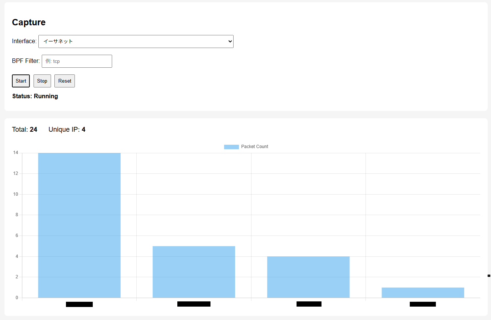

# IP Traffic Monitor Server

Python、Flask、Scapyを使用したWebベースのネットワークトラフィック監視ツールです。

Windowsのネットワークインターフェースを選択してIPv4パケットをキャプチャし、送信元IPアドレスごとのパケット数をブラウザ上に表示します。パケットキャプチャの開始・停止、BPFフィルターの指定、通信量の多い送信元IPアドレスの表示、統計情報のリセットができます。



## 機能

-   選択したネットワークインターフェースからIPv4パケットをキャプチャ
-   キャプチャしたパケットの総数を表示
-   送信元IPアドレスのユニーク数を表示
-   パケット数が多い送信元IPアドレスを上位10件表示
-   ブラウザからパケットキャプチャを開始・停止
-   `tcp` や `udp` などのBPFフィルターを指定
-   統計情報を自動更新

## 動作環境

本アプリケーションはWindows上でのローカル実行を想定しています。

  項目                           要件
  ------------------------------ -----------------------------
  OS                             Windows
  Python                         Python 3.13（動作確認環境）
  パケットキャプチャドライバー   Npcap
  Webフレームワーク              Flask
  パケットキャプチャ             Scapy
  グラフ表示                     Chart.js（CDNから読み込み）
  ブラウザ                       モダンブラウザ

Windowsでパケットをキャプチャするには、通常、管理者権限が必要です。また、Scapyがネットワークインターフェースにアクセスできるよう、Npcapを正しくインストールしてください。

## ディレクトリ構成

``` text
ip_traffic_monitor/
├── app.py
├── capture.py
├── LICENSE
└── README.md
```

-   `app.py` ---
    Flaskアプリケーション、Web画面、API、トラフィック統計を担当します。
-   `capture.py` --- Scapyを使用したパケットキャプチャを担当します。
-   `LICENSE` --- GNU General Public License version
    2のライセンス本文です。

## 環境構築

### 1. Pythonのインストール

Pythonがインストールされていない場合は、Windows用のPythonをインストールしてください。

開発時にはPython
3.13を使用しています。それ以外のバージョンでも動作する可能性はありますが、すべてのバージョンでの動作を確認しているわけではありません。

### 2. Npcapのインストール

以下の公式サイトからNpcapをダウンロードしてインストールしてください。

https://npcap.com/

Windows環境に適したインストールオプションを選択してください。インストール後、Npcapのドライバーが利用できることを確認してください。

### 3. 仮想環境の作成（推奨）

プロジェクトのディレクトリでPowerShellを開き、以下を実行します。

``` powershell
python -m venv .venv
```

仮想環境を有効化します。

``` powershell
.\.venv\Scripts\Activate.ps1
```

PowerShellの実行ポリシーによってスクリプトの実行がブロックされる場合は、環境に適した実行ポリシーを設定するか、仮想環境内のPython実行ファイルを直接使用してください。

### 4. Pythonパッケージのインストール

``` powershell
python -m pip install Flask scapy
```

## 実行手順

1.  管理者権限でPowerShellを起動します。
2.  プロジェクトのディレクトリに移動します。
3.  仮想環境を作成した場合は、有効化します。
4.  以下のコマンドでアプリケーションを起動します。

``` powershell
python app.py
```

5.  ブラウザで次のURLを開きます。

``` text
http://127.0.0.1:5000
```

6.  ネットワークインターフェースを選択し、必要に応じてBPFフィルターを入力します。
7.  **Start** ボタンをクリックすると、パケットキャプチャが開始されます。

**Stop** ボタンでパケットキャプチャの停止を要求できます。**Reset**
ボタンをクリックすると、表示中のパケット統計情報がリセットされます。

## BPFフィルターの例

BPFフィルター欄には、パケットキャプチャバックエンドがサポートするフィルターを指定できます。

  フィルター            説明
  --------------------- ----------------------------------------
  `tcp`                 TCPパケットをキャプチャ
  `udp`                 UDPパケットをキャプチャ
  `icmp`                ICMPパケットをキャプチャ
  `port 80`             ポート80を使用するパケットをキャプチャ
  `host 192.168.1.10`   指定したホストとの通信をキャプチャ

フィルターを空欄にすると、BPFによる追加の絞り込みを行わずにパケットをキャプチャします。

## 注意事項・制限事項

-   現在の実装はIPv4パケットを対象としています。IPv6通信は表示対象に含まれません。
-   本アプリケーションはローカル利用を想定しており、デフォルトでは
    `127.0.0.1` にバインドします。
-   管理者権限が不足している場合やNpcapを利用できない場合、パケットキャプチャに失敗することがあります。
-   **Stop**
    操作はパケットキャプチャの停止を要求します。パケットの受信状況やキャプチャバックエンドの動作によっては、停止までに時間がかかる場合があります。
-   Chart.jsは公開CDNから読み込むため、グラフの表示にはインターネット接続が必要になる場合があります。
-   本プロジェクトは学習、開発、ネットワークのトラブルシューティングを目的としています。監視する権限のあるネットワークおよびデバイスでのみ使用してください。

## ライセンス

本プロジェクトは **GNU General Public License version 2
only（GPL-2.0-only）** のもとで公開しています。

ライセンスの全文については、[LICENSE](LICENSE) を参照してください。

## 謝辞

本プロジェクトでは、以下のオープンソースソフトウェアおよびツールを使用しています。

-   [Scapy](https://scapy.net/) ---
    パケット操作およびネットワークパケットキャプチャ
-   [Flask](https://flask.palletsprojects.com/) ---
    Python製Webフレームワーク
-   [Chart.js](https://www.chartjs.org/) --- ブラウザ上でのグラフ表示
-   [Npcap](https://npcap.com/) ---
    Windows用パケットキャプチャライブラリ

各プロジェクトの開発者およびメンテナーの皆様に感謝します。
